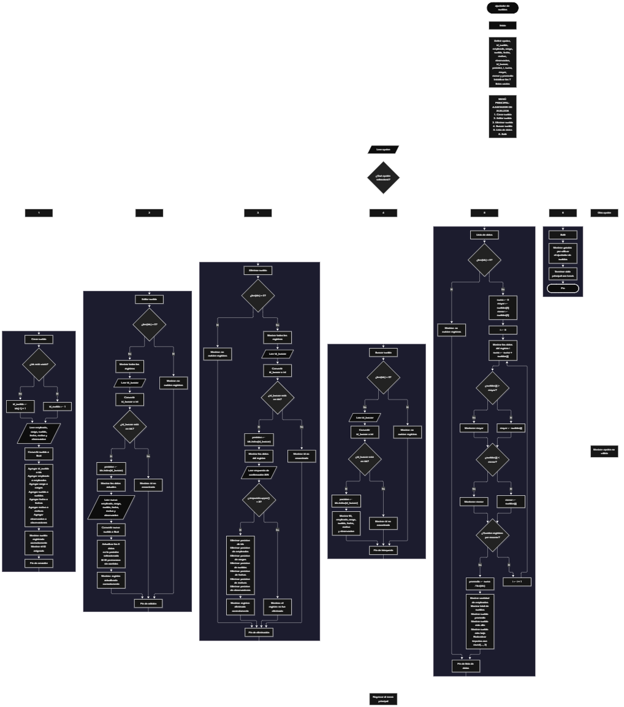

 

Este proyecto, llamado <b>ajustador de sueldos</b>, fue desarrollado en <b>python</b> como un ejercicio práctico para fortalecer la lógica de programación mediante la creación de un sistema de gestión de sueldos desde la consola. El programa cuenta con un menú principal de seis opciones que permite <b>crear, editar, eliminar, buscar y listar registros de sueldos</b>, además de consultar estadísticas generales de los empleados registrados. Cada registro almacena información como el identificador, el nombre del empleado, el cargo, el sueldo, la fecha del ajuste, el motivo y las observaciones, utilizando siete listas paralelas que mantienen los datos relacionados durante la ejecución. Durante su desarrollo se aplicaron conceptos fundamentales de programación, como variables, listas, estructuras condicionales, ciclos repetitivos, operadores aritméticos y métodos para agregar, buscar, modificar y eliminar registros. Este proyecto permite poner en práctica los conocimientos adquiridos en python y sirve como base para desarrollar sistemas de gestión salarial más avanzados utilizando otros lenguajes y tecnologías.

<h2 align="center">⚙️ Funcionamiento del menú principal</h2>

### ➕ Crear sueldo

La opción <b>1) crear sueldo</b> permite registrar un nuevo empleado en el sistema de gestión salarial. Antes de realizar el registro, el programa comprueba si la lista <b>ids</b> está vacía mediante la condición <b>len(ids) == 0</b>. Si no existen registros, asigna el identificador inicial <b>1</b> a la variable <b>id_sueldo</b>. En caso contrario, calcula el siguiente identificador sumando uno al último valor almacenado mediante la expresión <b>ids[-1] + 1</b>. Después, solicita el <b>nombre del empleado, cargo, sueldo, fecha del ajuste, motivo del ajuste y observación</b>. El sueldo se convierte a un valor numérico de tipo <b>float</b>, mientras que los demás datos se almacenan como texto. A continuación, utiliza el método <b>append()</b> para agregar el identificador y los datos correspondientes a sus respectivas listas. Finalmente, muestra el mensaje <b>"sueldo registrado correctamente."</b> e informa el identificador asignado. Esta operación permite incorporar nuevos registros y mantener relacionada la información de cada empleado.

### ✏️ Editar sueldo

La opción <b>2) editar sueldo</b> permite modificar la información de un empleado registrado. Primero, el programa comprueba si existen registros mediante la condición <b>len(ids) == 0</b>. Si no hay información almacenada, muestra el mensaje <b>"no existen registros."</b>. En caso contrario, presenta una lista con el identificador, nombre, cargo, sueldo, fecha, motivo y observaciones de cada registro. Después, solicita el identificador que se desea editar y lo convierte a un número entero mediante <b>int()</b>. Si el identificador existe en la lista <b>ids</b>, utiliza el método <b>index()</b> para obtener la posición correspondiente y muestra los datos actuales. A continuación, solicita el nuevo nombre del empleado, cargo, sueldo, fecha del ajuste, motivo y observación, actualizando directamente los valores de las siete listas en la posición seleccionada. Finalmente, presenta el mensaje <b>"registro actualizado correctamente."</b>. Si el identificador no se encuentra, muestra el mensaje <b>"id no encontrada."</b>. Esta operación permite actualizar todos los datos de un registro existente, sin conservar automáticamente los valores anteriores.

### 🗑️ Eliminar sueldo

La opción <b>3) eliminar sueldo</b> permite eliminar un registro del sistema mediante su identificador. Antes de comenzar, el programa comprueba si existen registros. Si las listas están vacías, muestra el mensaje <b>"no existen registros."</b>. Si hay datos disponibles, presenta una lista con la información de los empleados y solicita el identificador del registro que se desea eliminar. Después, comprueba si el identificador existe en la lista <b>ids</b> y, si lo encuentra, obtiene su posición mediante <b>index()</b> y muestra los datos correspondientes. A continuación, solicita confirmación mediante la pregunta <b>"¿desea eliminar este registro? (s/n): "</b>. La respuesta se convierte a mayúsculas mediante <b>upper()</b>, lo que permite aceptar tanto <b>"S"</b> como <b>"s"</b>. Si el usuario confirma, el programa utiliza <b>pop(posicion)</b> para eliminar los datos de esa misma posición en las siete listas: <b>ids, empleados, cargos, sueldos, fechas, motivos y observaciones</b>. Finalmente, muestra el mensaje <b>"registro eliminado correctamente."</b>. Si la respuesta no es afirmativa, presenta el mensaje <b>"el registro no fue eliminado."</b>. Si el identificador no existe, informa que no fue encontrado.

### 🔎 Buscar sueldo

La opción <b>4) buscar sueldo</b> permite localizar un registro mediante su identificador. Primero, el programa comprueba si existen datos almacenados. Si no hay registros, muestra el mensaje <b>"no existen registros."</b>. En caso contrario, solicita el identificador que se desea buscar y lo convierte a un número entero mediante <b>int()</b>. Después, utiliza la condición <b>id_buscar in ids</b> para comprobar si el identificador está registrado. Si existe, obtiene la posición correspondiente mediante <b>ids.index(id_buscar)</b> y muestra el identificador, nombre del empleado, cargo, sueldo, fecha del ajuste, motivo y observaciones. Si el identificador no aparece en la lista, presenta el mensaje <b>"id no encontrada."</b>. Esta función permite consultar los datos de un empleado específico sin necesidad de recorrer visualmente todos los registros.

### 📋 Lista de datos

La opción <b>5) lista de datos</b> permite visualizar todos los registros almacenados y calcular estadísticas generales de los sueldos. Antes de iniciar, el programa comprueba si la lista <b>ids</b> está vacía. Si no existen registros, muestra el mensaje <b>"no existen registros."</b>. En caso contrario, inicializa la variable <b>suma</b> con el valor <b>0</b> y establece las variables <b>mayor</b> y <b>menor</b> con el primer sueldo almacenado en <b>sueldos[0]</b>. Después, utiliza un ciclo <b>for</b> para recorrer los registros, mostrar sus datos, acumular los sueldos y comparar cada importe con los valores de mayor y menor. Al finalizar el recorrido, calcula el promedio mediante la expresión <b>suma / len(ids)</b>. Finalmente, muestra la cantidad de empleados, el total de sueldos, el sueldo promedio, el sueldo más alto y el sueldo más bajo. Para presentar los importes con dos decimales, utiliza la función <b>round()</b>. Estas estadísticas se calculan a partir de los sueldos actualmente registrados en el sistema.

### 🚪 Salir del menú principal

La opción <b>6) salir</b> permite finalizar la ejecución del programa. Cuando el usuario selecciona esta opción, el sistema muestra el mensaje <b>"gracias por utilizar el ajustador de sueldos."</b> y utiliza la instrucción <b>break</b> para interrumpir el ciclo principal <b>while True</b>. De esta manera, el menú deja de mostrarse y el programa termina su ejecución. Si el usuario introduce un valor que no coincide con ninguna de las seis opciones, se ejecuta el bloque <b>else</b>, que muestra el mensaje <b>"opción no válida."</b> y permite regresar al menú principal.

<h2 align="center">🧠 Temas aplicados en el proyecto</h2>

### 📦 Variables

En este proyecto se utilizan variables para almacenar los datos introducidos por el usuario, controlar los identificadores de los registros, localizar la posición de un empleado y calcular las estadísticas salariales. También se utilizan variables de control para seleccionar las opciones del menú y determinar los resultados de las operaciones. Cada variable cumple una función específica dentro del sistema de gestión de sueldos.

🔢 **Opcion:** Almacena la opción seleccionada por el usuario en el menú principal.

🆔 **Id_sueldo:** Almacena el identificador que se asigna al nuevo registro.

👤 **Empleado:** Guarda el nombre del empleado que se registra o actualiza.

💼 **Cargo:** Almacena el cargo correspondiente al empleado.

💰 **Sueldo:** Guarda el importe salarial introducido por el usuario.

📅 **Fecha:** Almacena la fecha del ajuste salarial.

📝 **Motivo:** Guarda el motivo por el cual se registra o actualiza el sueldo.

📄 **Observacion:** Almacena información adicional relacionada con el registro.

🔎 **Id_buscar:** Guarda el identificador introducido para localizar un registro.

📍 **Posicion:** Indica la posición de las listas en la que se encuentra el registro seleccionado.

🔁 **I:** Funciona como contador en los ciclos <b>for</b> utilizados para recorrer y mostrar los registros.

➕ **Suma:** Acumula los importes de los sueldos para calcular el total.

📈 **Mayor:** Almacena temporalmente el sueldo más alto encontrado durante el recorrido.

📉 **Menor:** Almacena temporalmente el sueldo más bajo encontrado durante el recorrido.

📊 **Promedio:** Guarda el resultado de dividir la suma de los sueldos entre la cantidad de registros.

### 🗃️ Listas

En este proyecto se utilizan siete listas paralelas para almacenar la información de los empleados y sus sueldos. Cada lista contiene un tipo específico de dato y utiliza la misma posición para relacionarlo con el resto de la información de un registro. Por ejemplo, los datos de un empleado almacenado en la posición <b>0</b> se encuentran distribuidos entre <b>ids[0], empleados[0], cargos[0], sueldos[0], fechas[0], motivos[0] y observaciones[0]</b>. Esta organización permite agregar, consultar, modificar y eliminar registros manteniendo la correspondencia entre los datos.

🆔 **Ids:** Almacena los identificadores asignados a los registros de sueldos.

👤 **Empleados:** Almacena los nombres de los empleados registrados.

💼 **Cargos:** Guarda los cargos correspondientes a cada empleado.

💰 **Sueldos:** Almacena los importes salariales de los empleados.

📅 **Fechas:** Guarda las fechas asociadas a los ajustes salariales.

📝 **Motivos:** Almacena los motivos de los ajustes de sueldo.

📄 **Observaciones:** Guarda las observaciones adicionales de cada registro.

### 🔀 Estructuras condicionales

En este proyecto se utilizan las estructuras <b>if</b>, <b>elif</b> y <b>else</b> para controlar el funcionamiento del menú y las operaciones disponibles. Estas condiciones permiten determinar qué acción ejecutar según la opción seleccionada, comprobar si existen registros antes de realizar una operación, verificar si un identificador se encuentra almacenado y decidir si un registro debe eliminarse según la respuesta de confirmación. También se utilizan comparaciones para determinar cuál es el sueldo más alto y cuál es el más bajo. Gracias a estas estructuras, el programa puede responder de manera diferente según los datos disponibles y las decisiones del usuario.

### 🔄 Estructuras repetitivas

En este proyecto se utilizan los ciclos <b>while True</b> y <b>for</b>. El ciclo <b>while True</b> mantiene activo el menú principal y permite ejecutar distintas operaciones hasta que se selecciona la opción de salida, que utiliza <b>break</b> para finalizar la repetición. Por otro lado, los ciclos <b>for</b> permiten recorrer las listas mediante la función <b>range(len(ids))</b> para mostrar los registros existentes y calcular las estadísticas salariales. Estas estructuras facilitan la administración de múltiples empleados sin tener que escribir instrucciones individuales para cada registro.

### 🎯 Estructura de selección

El programa utiliza una cadena de condiciones <b>if, elif y else</b> para seleccionar la operación correspondiente a la opción introducida por el usuario. Las opciones disponibles permiten crear, editar, eliminar y buscar sueldos, consultar la lista de datos y salir del sistema. Cada condición ejecuta un bloque de instrucciones específico y el último bloque <b>else</b> muestra el mensaje <b>"opción no válida."</b> cuando el valor introducido no coincide con ninguna de las opciones disponibles. Esta estructura organiza el menú principal y facilita la ejecución de las distintas funcionalidades.

### 🔢 Organización de las listas

Las siete listas del proyecto se encuentran relacionadas mediante índices compartidos. A diferencia de los arreglos de tamaño fijo, las listas de Python pueden aumentar o disminuir su longitud durante la ejecución. Al crear un registro, el programa utiliza <b>append()</b> para agregar un elemento a cada lista. Al editarlo, actualiza los valores en la posición correspondiente. Al eliminarlo, utiliza <b>pop(posicion)</b> para retirar el elemento de cada lista. La cantidad de registros existentes se obtiene mediante <b>len(ids)</b>, que permite controlar los recorridos y calcular las estadísticas. El programa no establece una capacidad máxima de registros.

### 🔄 Reorganización de registros

Cuando se elimina un sueldo, el programa identifica la posición del registro mediante <b>ids.index(id_buscar)</b> y utiliza <b>pop(posicion)</b> para retirar los elementos correspondientes de las siete listas. Python reorganiza automáticamente los elementos restantes para cerrar el espacio dejado por la eliminación. De esta manera, los registros posteriores mantienen su correspondencia entre las listas. Sin embargo, el identificador eliminado no se utiliza como criterio para calcular el siguiente identificador: este se obtiene a partir del último elemento que permanezca en la lista <b>ids</b>. Por ello, si se elimina el último registro, el siguiente registro creado puede recibir nuevamente un identificador que ya se había utilizado.

<h2 align="center">¿Cómo se implementaron las operaciones crud en el proyecto?</h2>

Las operaciones <b>crud</b> se implementaron mediante las opciones del menú principal, permitiendo administrar los registros de sueldos. La operación <b>crear</b> corresponde a <b>crear sueldo</b>, donde se solicitan los datos de un empleado y se agregan a las listas mediante <b>append()</b>. La operación <b>leer</b> se realiza mediante las opciones <b>buscar sueldo</b> y <b>lista de datos</b>, que permiten consultar un registro individual o visualizar todos los registros junto con sus estadísticas. La operación <b>actualizar</b> corresponde a <b>editar sueldo</b>, donde se reemplazan los datos almacenados en la posición seleccionada. Por último, la operación <b>eliminar</b> se realiza mediante <b>eliminar sueldo</b>, que solicita confirmación y utiliza <b>pop()</b> para retirar los datos de las siete listas. Estas operaciones trabajan con información almacenada temporalmente durante la ejecución del programa.

<h2 align="center">Diagrama de flujo del proyecto</h2>

<h2 align="center">🛡️ Validaciones del programa</h2>

### 📭 No existen registros

Esta comprobación se utiliza en las opciones de <b>editar sueldo, eliminar sueldo, buscar sueldo y lista de datos</b>. El programa verifica si la lista <b>ids</b> está vacía mediante la condición <b>len(ids) == 0</b>. Si no existen registros, muestra el mensaje <b>"no existen registros."</b> y evita continuar con las operaciones que necesitan datos almacenados. Esta comprobación también impide que la opción de estadísticas intente acceder a <b>sueldos[0]</b> cuando no hay empleados registrados.

### 🔎 Identificador no encontrado

Esta comprobación se utiliza durante las operaciones de edición, eliminación y búsqueda de sueldos. El programa verifica si el identificador introducido se encuentra en la lista <b>ids</b> mediante la condición <b>id_buscar in ids</b>. Si existe, utiliza <b>index()</b> para localizar su posición y ejecutar la operación correspondiente. Si no se encuentra, muestra el mensaje <b>"id no encontrada."</b>. Esta comprobación permite evitar modificaciones, consultas o eliminaciones sobre identificadores que no están almacenados.

### ⚠️ Confirmación de eliminación

Esta comprobación se utiliza antes de eliminar un registro. El programa solicita al usuario que confirme la operación y transforma la respuesta a mayúsculas mediante <b>upper()</b>. Si el resultado es igual a <b>"S"</b>, elimina los datos correspondientes de las siete listas. Si la respuesta es diferente, muestra el mensaje <b>"el registro no fue eliminado."</b> y conserva el registro. Esta confirmación permite evitar eliminaciones accidentales cuando el usuario decide no continuar con la operación.

### 🔢 Conversión de datos numéricos

El programa utiliza las funciones <b>int()</b> y <b>float()</b> para convertir los valores introducidos por el usuario. La función <b>int()</b> se utiliza para convertir los identificadores y <b>float()</b> para convertir los sueldos. Sin embargo, el código actual no incluye bloques <b>try/except</b> para controlar entradas que no puedan convertirse a los tipos numéricos esperados. Si se introduce texto no válido en alguno de estos campos, puede producirse un error y detener la ejecución del programa.

### 💰 Cálculo de estadísticas salariales

La opción <b>5) lista de datos</b> comprueba que existan registros antes de calcular las estadísticas. Cuando hay datos disponibles, inicializa las variables <b>mayor</b> y <b>menor</b> con el primer sueldo registrado y utiliza un ciclo <b>for</b> para comparar los demás valores. La variable <b>suma</b> acumula los importes y la variable <b>promedio</b> obtiene el resultado de dividir el total entre la cantidad de registros. La función <b>round()</b> permite mostrar los resultados con dos decimales. No obstante, el código no valida que los sueldos sean positivos, por lo que los valores negativos también pueden participar en los cálculos.

### ⚠️ Opción no válida

El menú principal incluye un bloque <b>else</b> que muestra el mensaje <b>"opción no válida."</b> cuando el usuario introduce una opción distinta de los valores comprendidos entre <b>1</b> y <b>6</b>. Después de mostrar el mensaje, el ciclo <b>while True</b> continúa ejecutándose y vuelve a presentar el menú principal. Esta estructura permite que el usuario seleccione otra opción sin necesidad de reiniciar el programa.

<h2 align="center">🎯 Objetivo del proyecto</h2>

El objetivo principal de este proyecto es fortalecer la <b>lógica de programación</b> mediante el desarrollo de un sistema de gestión de sueldos en <b>python</b>. A través de su construcción se busca aplicar los conocimientos adquiridos sobre variables, listas, estructuras condicionales, ciclos repetitivos, operadores y métodos para manipular colecciones de datos. Además, el proyecto permite comprender cómo registrar, consultar, modificar y eliminar información mediante operaciones CRUD, así como realizar cálculos estadísticos sobre los sueldos almacenados. De esta manera, constituye una base práctica para desarrollar sistemas de gestión de empleados y administración salarial más completos utilizando otros lenguajes y tecnologías.

